<div align="center">

<a href="https://e-cinema.net">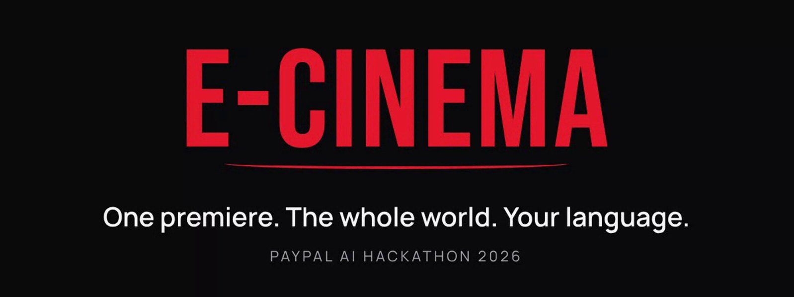</a>

<h3>A live, worldwide cinema for new films.</h3>

<p>Every film premieres once, at one time, for everyone. You pay in your own currency, hear the film dubbed in your language,<br>and talk with the whole room in a world chat translated for you. An AI agent books your seats; you approve every payment with PayPal.</p>

<p>
  <a href="https://e-cinema.net"></a>
  <a href="#paypal"></a>
  <a href="#ai"></a>
  <a href="#license"></a>
</p>

<p>
  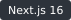
  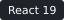
  
  
  
  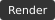
  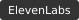
  
  
</p>

<p>
  <a href="#what-it-is"><b>What it is</b></a> ·
  <a href="#tour"><b>Tour</b></a> ·
  <a href="#paypal"><b>PayPal</b></a> ·
  <a href="#ai"><b>AI</b></a> ·
  <a href="#how-it-works"><b>How it works</b></a> ·
  <a href="#run-it-locally"><b>Run it</b></a> ·
  <a href="#roadmap"><b>Roadmap</b></a>
</p>

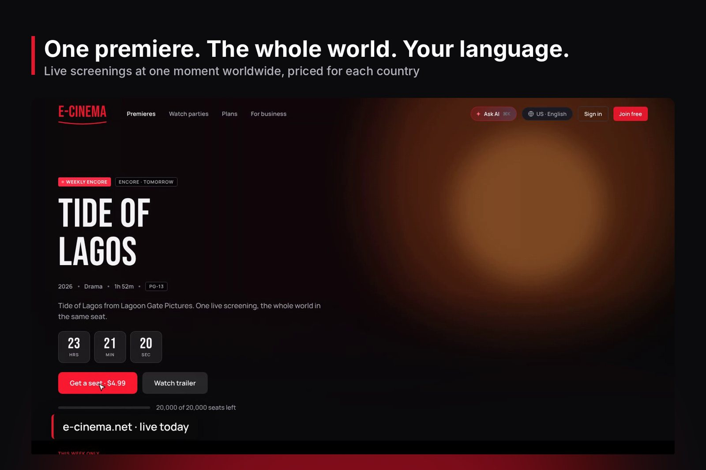

</div>

---

## Latest

- **2026-11-08** The repository is public under AGPL-3.0, with a merge guard that checks every pull request for leaked keys, malware and unapproved authors.
- **2026-11-08** The first watch room premiere ran live, with AI dubs in Yorùbá, French and Hindi you can switch to in the middle of the film.
- **2026-11-07** E-Cinema AI books real sandbox seats end to end: hold, PayPal order, approval, capture and ticket, tested on every push.
- **2026-11-01** Paystack and Flutterwave checkout for naira payments in Nigeria, next to PayPal everywhere else.
- **2026-10-31** e-cinema.net went live on Render, with Render Workflows paying studios their share through PayPal Payouts.

## What it is

New films reach the world one country at a time. Most people wait months, watch a pirated copy, or never see the film in a language they understand. Studios lose the opening night, the audience, and the money.

E-Cinema gives every new film **one global premiere night**:

1. **One time, everyone.** A film opens once, worldwide, in a synced watch room. It comes back as a weekly encore for anyone who missed it.
2. **Your language, your money.** Prices are set per country and paid in local currency. Claude writes the dub script and subtitles, and ElevenLabs voices the dub, so you can switch language mid-film.
3. **A real room.** A world chat translated for each viewer, polls, reactions, "Shop the film" and a VR hall. Arrive late and AI tells you what you missed.
4. **An agent that books, a person who pays.** Ask E-Cinema AI for "two seats for Friday's premiere" and it finds the showing, holds the seats and builds a PayPal order. It can't move money: you approve in PayPal.
5. **Fair to studios.** Studios upload, set prices, review AI dubs and watch the room live. After each premiere they are paid 70% automatically.

## Tour

<table>
<tr>
<td width="50%" valign="top">
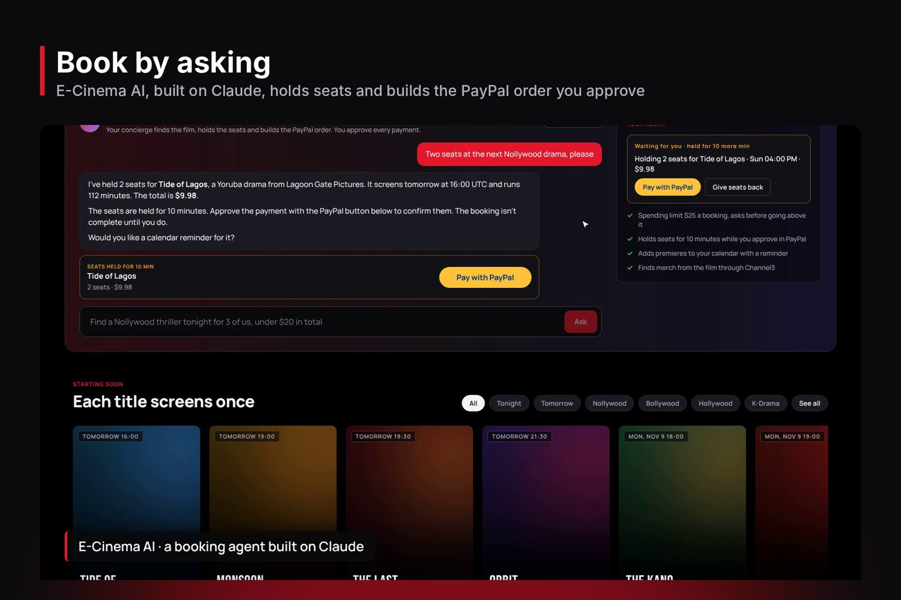
<p><b>E-Cinema AI books the seats.</b> Claude finds the showing, holds two seats for 10 minutes and hands back a PayPal order to approve.</p>
</td>
<td width="50%" valign="top">
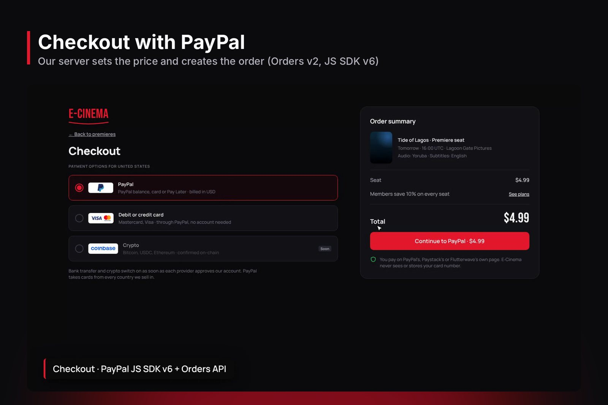
<p><b>Checkout with PayPal.</b> The server prices the order from its own catalogue. Pay Later is offered on bigger baskets.</p>
</td>
</tr>
<tr>
<td width="50%" valign="top">
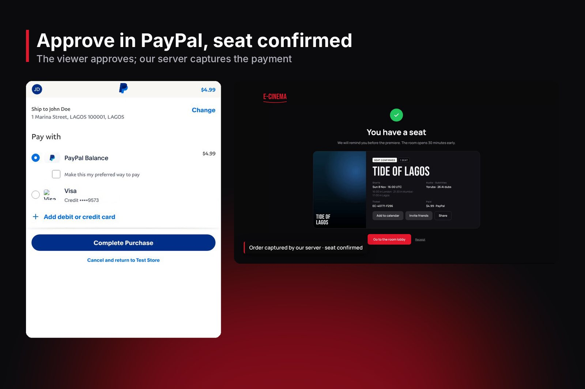
<p><b>Approved and confirmed.</b> The capture turns the hold into a ticket. Cancelling a ticket refunds it once, safely.</p>
</td>
<td width="50%" valign="top">
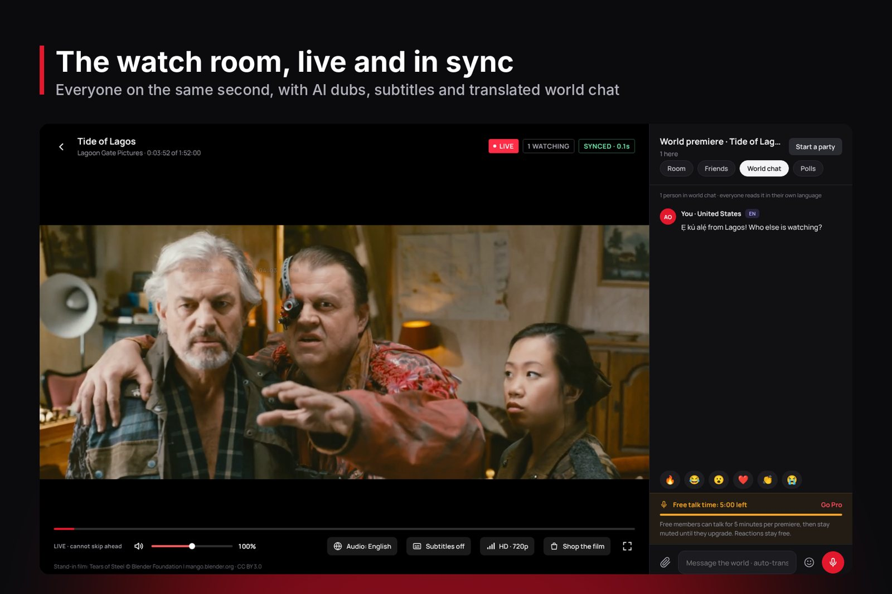
<p><b>The watch room.</b> Synced playback, AI dubs and subtitles, and a world chat translated for every viewer.</p>
</td>
</tr>
<tr>
<td width="50%" valign="top">
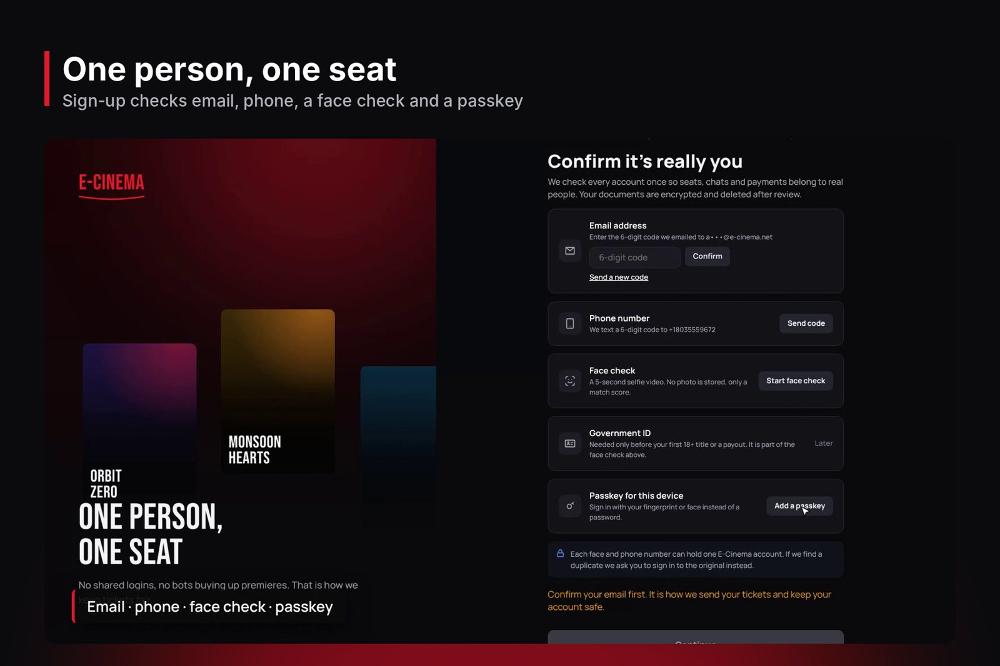
<p><b>One person, one seat.</b> Email, phone, a 5-second face check and a passkey. No shared logins, no bots buying up premieres.</p>
</td>
<td width="50%" valign="top">
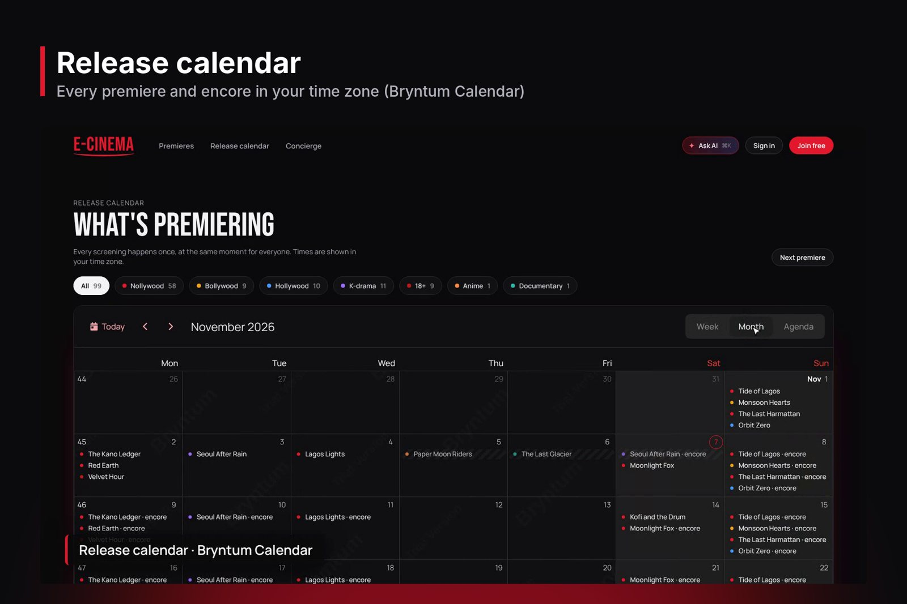
<p><b>Release calendar.</b> Every premiere and encore, with genre filters and tap-to-book.</p>
</td>
</tr>
<tr>
<td width="50%" valign="top">
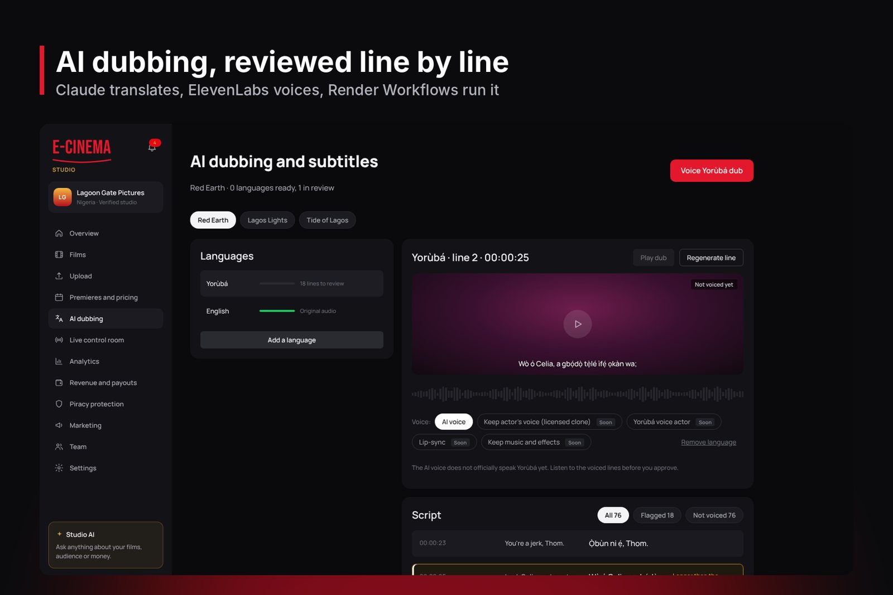
<p><b>Studio portal.</b> Upload, set prices per country, and review each AI dub line by line before it goes live.</p>
</td>
<td width="50%" valign="top">
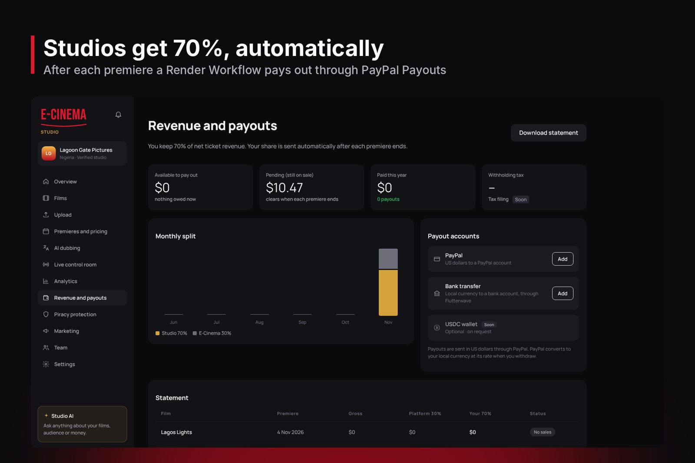
<p><b>Studio payouts.</b> A Render Workflow pays each studio's 70% share through PayPal Payouts after every showing.</p>
</td>
</tr>
</table>

<sub>Screenshots are from the live site with sample films and sandbox payments.</sub>

### Try it

| Page | What happens there |
| --- | --- |
| [`/`](https://e-cinema.net) | The next premiere, with a countdown and prices in your currency |
| [`/join`](https://e-cinema.net/join) | Sign-up with email, phone, face check and passkey |
| [`/concierge`](https://e-cinema.net/concierge) | E-Cinema AI books seats and returns a PayPal order |
| `/checkout?film=<showtime id>` | PayPal checkout, plus Paystack and Flutterwave in Nigeria |
| [`/tickets`](https://e-cinema.net/tickets) | Your seats. Cancelling one refunds the PayPal capture |
| `/room/<showtime id>` | The watch room: translated chat, AI dubs, polls, Shop the film, VR mode |
| [`/releases`](https://e-cinema.net/releases) | The release calendar |
| [`/studio`](https://e-cinema.net/studio) | The studio portal: films, prices, dubs, live control room, payouts |
| [`/executive`](https://e-cinema.net/executive) | Executive dashboards, including "PayPal and agents" |

PayPal runs in sandbox mode, so no real money moves.

<h2 id="paypal">How PayPal is used</h2>

| PayPal product | What it does in E-Cinema | Code |
| --- | --- | --- |
| **JavaScript SDK v6 + Orders v2** | Tickets, gifts, pre-orders, 18+ unlocks, merch and every agent booking. The server prices, creates and captures each order | `web/app/checkout`, `web/app/api/paypal/`, `web/lib/paypal.ts` |
| **Server SDK** (`@paypal/paypal-server-sdk`) | Typed orders, captures and refunds | `web/lib/paypal.ts` |
| **Pay Later** | Pre-orders and larger baskets | `web/lib/pay-methods.ts` |
| **Subscriptions** | Pro, VIP, Student and Family plans, per currency, monthly or yearly | `web/lib/paypal-subs.ts` |
| **Refunds** | Cancelling a seat refunds the capture, keyed so it only refunds once | `web/app/api/tickets/[id]/cancel/route.ts` |
| **Webhooks** (signature verified) | Captures, disputes, subscriptions and sales keep tickets and plans in step | `web/app/api/paypal/webhooks/route.ts` |
| **Payouts** | Each studio's 70% share after every showing, idempotent per showing | `workflows/src/payouts.ts` |
| **Disputes** | Open disputes and deadlines on the executive dashboard | `web/components/exec/ExecPayPal.tsx` |

<h2 id="ai">How AI is used</h2>

| Job | Model or service | Code |
| --- | --- | --- |
| **E-Cinema AI**, the booking agent: finds showtimes, holds seats, builds PayPal orders, adds to calendar, shops the film. It never captures money and asks before anything over its spending limit | Claude Opus 5.5 with six tools | `web/lib/concierge.ts` |
| Dub scripts and subtitles in each language | Claude Sonnet 5.5 | `web/lib/dub-worker.ts`, `workflows/src/subtitles.ts` |
| Dub voices | ElevenLabs `eleven_multilingual_v2` | `workflows/src/dubbing.ts` |
| World chat and message translation | Claude Sonnet 5.5 | `web/lib/room-chat.ts`, `web/lib/chat.ts` |
| "What you missed" for late arrivals | Claude Sonnet 5.5 | `web/lib/catchup.ts` |
| Audience mood in the studio control room, price suggestions per country, studio Q&A on their own numbers | Claude Sonnet 5.5 | `web/lib/control-ai.ts`, `web/lib/price-ai.ts`, `web/lib/studio-ai.ts` |
| Piracy takedown notices from leak traces | Claude Sonnet 5.5 | `web/lib/leak-notice.ts` |
| Face liveness and ID checks | Sumsub | `api/internal/identity` |

## Built with our partners

| Tool | Where it shows up |
| --- | --- |
| **APIMatic** | The APIMatic PayPal context plugin guided every line of PayPal code, built on the APIMatic-generated `@paypal/paypal-server-sdk` |
| **AG Grid** | The "PayPal and agents" executive dashboard: revenue by film, refund rate, disputes and studio payouts (`web/components/PaymentsGrid.tsx`) |
| **Bryntum Calendar** | The release calendar at `/releases` and the week view on `/home` (`web/components/ReleaseCalendar.tsx`) |
| **Channel3** | "Shop the film" in the watch room and through E-Cinema AI (`web/lib/shop.ts`) |
| **Render** | The web app, Go API, PostgreSQL and **Render Workflows** for dubbing, subtitles and payouts (`render.yaml`, `workflows/`) |

## How it works

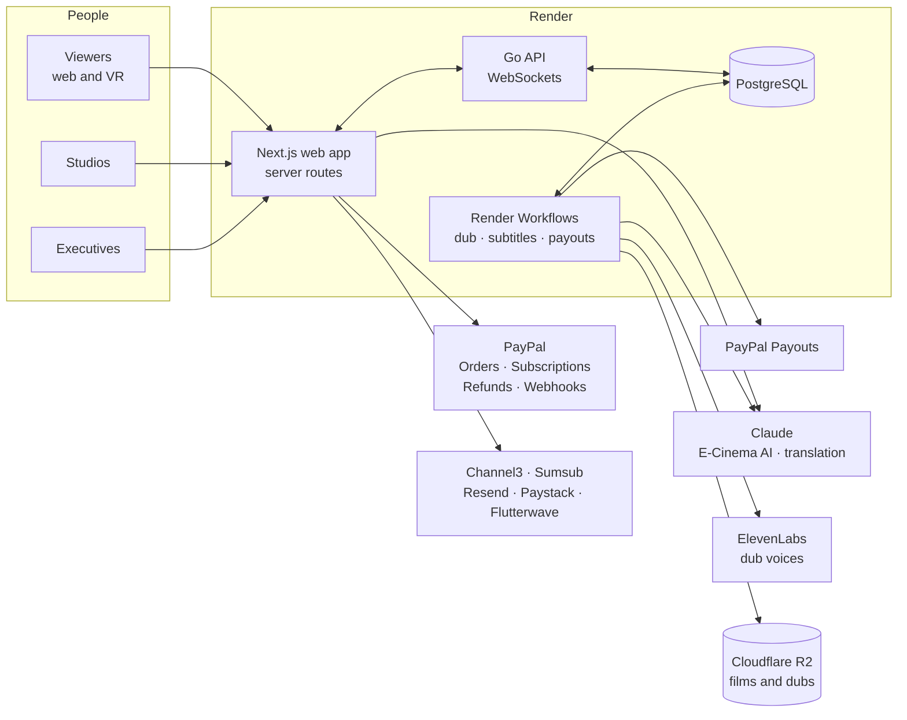

- **The agent proposes, the person pays.** E-Cinema AI can hold seats and create an order, but only the viewer's approval in PayPal captures money. Bookings over the spending limit always ask first.
- **The server sets the price.** Every order is priced from the server's own catalogue, never from the browser.
- **Money moves once.** Refunds and payouts carry idempotency keys, so a retry never pays or refunds twice.
- **Heavy work runs in the background.** Dubbing, subtitles and studio payouts run as Render Workflows tasks, so nobody waits on them.

### Repository layout

| Path | What it holds |
| --- | --- |
| [`web/`](web/) | Next.js web app and server routes (TypeScript) |
| [`api/`](api/) | Go API: accounts, tickets, rooms, studios, executive data. SQL migrations run on start |
| [`workflows/`](workflows/) | Render Workflows tasks (TypeScript) |
| [`ops/`](ops/) | Deploy scripts for Render and Cloudflare |
| [`design/`](design/), [`docs/`](docs/) | Design tokens, screen specs, product decisions and the [PayPal plan](docs/paypal-plan.md) |
| [`.github/workflows/`](.github/workflows/) | CI, including a real PayPal sandbox order and an agent booking on every push, plus the merge guard |

Every screen was designed in [Figma](https://www.figma.com/design/M2RESyD3zhwTZfV7VXrBW3/E-Cinema) before it was built.

## Run it locally

You need Node 22, Go 1.24 and PostgreSQL 16.

```sh
# 1. Database
createdb ecinema

# 2. API (migrations run on start)
cd api
DATABASE_URL=postgres://localhost/ecinema?sslmode=disable \
INTERNAL_API_TOKEN=dev-token \
PORT=8080 go run ./cmd/api

# 3. Web app, in a second terminal
cd web
npm ci
API_URL=http://localhost:8080 \
INTERNAL_API_TOKEN=dev-token \
PAYPAL_CLIENT_ID=<sandbox client id> \
PAYPAL_CLIENT_SECRET=<sandbox secret> \
ANTHROPIC_API_KEY=<key> \
npm run dev
# open http://localhost:3000

# 4. Workflows (optional: dubbing, subtitles, payouts)
cd workflows
npm ci && npm test
```

<details>
<summary><b>Optional keys</b></summary>
<br>

| Key | Switches on |
| --- | --- |
| `CHANNEL3_API_KEY` | Shop the film |
| `ELEVENLABS_API_KEY` | AI dub voices |
| `R2_*` | Film and dub storage |
| `RESEND_API_KEY` | Email |
| `SUMSUB_APP_TOKEN`, `SUMSUB_SECRET_KEY` | Face and ID checks |
| `PAYSTACK_SECRET_KEY`, `FLUTTERWAVE_SECRET_KEY` | Naira payments |
| `NEXT_PUBLIC_AG_GRID_LICENSE_KEY` | AG Grid Enterprise features |

Without a key, that feature shows as unavailable instead of failing. PayPal settings (`PAYPAL_CLIENT_ID`, `PAYPAL_CLIENT_SECRET`, `PAYPAL_ENV`, `PAYPAL_WEBHOOK_ID`) default to the sandbox.

</details>

Production deploys go to Render through [`render-deploy.yml`](.github/workflows/render-deploy.yml).

## Roadmap

- [x] Global premieres with weekly encores and per-country prices
- [x] Sign-up with face check and passkeys: one person, one seat
- [x] E-Cinema AI booking with PayPal orders, refunds, subscriptions and webhooks
- [x] Synced watch room with translated chat, AI dubs, subtitles and a VR hall
- [x] Studio portal with AI dub review, live control room and PayPal Payouts
- [x] Paystack and Flutterwave for Nigeria
- [ ] PayPal Vault, so E-Cinema AI can finish small bookings inside a viewer's own limit
- [ ] PayPal Agent Toolkit and MCP server for finance agents (payout reconciliation, dispute evidence)
- [ ] PayPal Invoicing for merch licensees and group bookings, and Donations for the 18+ charity stage
- [ ] Live payments and the first licensed premieres with partner studios
- [ ] The Android app (already designed), voice-cloned dubs with lip-sync, more local payment methods

## Security

Every pull request runs the [merge guard](.github/workflows/merge-guard.yml): a leaked key and password scan, a malware and executable scan, a dependency vulnerability check, and a check on who authored each commit. Found a security problem? Please follow [SECURITY.md](SECURITY.md) instead of opening an issue.

## License

Copyright © 2026 Online Cinema Ltd, trading as E-Cinema (RC 9947766).

Online Cinema Ltd owns all of E-Cinema: the code, the designs, the brand and the content.

- **Code:** licensed under the [GNU Affero General Public License v3.0](LICENSE). Anyone who uses it in software they distribute or in an online service must publish their full source under the same license. For any other use, a commercial license is available from admin@e-cinema.net.
- **Designs, name, logo, screenshots and content:** all rights reserved by Online Cinema Ltd. They may not be copied or used without written permission.

See [NOTICE.md](NOTICE.md).

<div align="center">
<br>
<sub>Made in Lagos by <a href="https://github.com/Bolajiomo99">Bolaji Jimoh Adigun</a> and the E-Cinema team.</sub>
</div>
